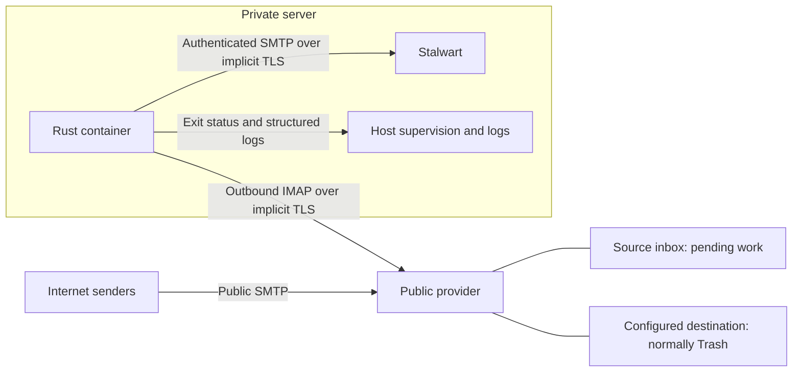
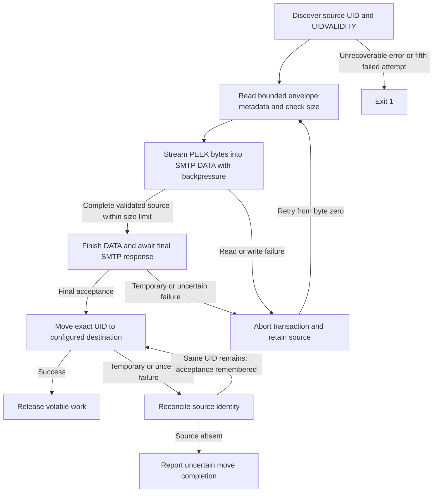

# Email Ingestor: context and architecture

Status: agreed v1 scope, updated 10 October 2026; implementation is planned. See [requirements](requirements.md), [test cases](test-cases.md), and [technology stack](tech-stack.md).

## 1. Context and boundary

The publicly reachable provider accepts internet email while the private server is offline. A Rust container on the private server initiates an IMAP connection to that provider and authenticated SMTP to private Stalwart. Both connections use validated implicit TLS. Stalwart needs no public incoming SMTP port for this workflow.

The ingestor transfers original messages. Stalwart owns storage, client access, Sieve, spam filtering, and all decisions after SMTP acceptance. Final mailbox verification is a general non-goal: accepted messages can legitimately be routed, redirected, or discarded.

## 2. Scope and simplifying decisions

| Area | V1 decision |
| --- | --- |
| Topology | One account, one source folder, one configured local recipient, one active container per account |
| Upstream processing | Always move accepted messages immediately to one explicitly configured existing destination, normally actual Trash |
| Durable state | Source-folder membership only; no database, local journal/spool, delivery keywords, or persistent volume |
| Compatibility | One tested upstream provider initially; password/app-password authentication, implicit TLS, native UID MOVE required |
| Discovery | Automatic IDLE when supported, polling fallback, periodic reconciliation |
| Configuration | Essential endpoint, credential, recipient, folder, CA, size, and log settings through environment variables |
| Scheduling | Fixed timing/queue/retry defaults and one active submission; no strategy or tuning switches |
| Large messages | Default 250 MiB raw-message limit; bounded IMAP-to-SMTP streaming with backpressure and no whole-message buffer or disk spool |
| Operations | Structured logs and process exit; fail immediately on unrecoverable errors or the fifth consecutive failed attempt |
| Releases | Branch/PR checks; main validation followed by one build/smoke/publish job without transferring an image artifact between jobs |

There is one processing path and no retention mode. The operator chooses the destination path; choosing an ordinary archive folder changes provider retention, not ingestor behavior. No automatic special-use discovery, folder creation, delayed cleanup, or hard deletion is included.

Provider selection and deployed Stalwart version remain deployment inputs. Validate one provider before the first release; broad provider compatibility, STARTTLS, OAuth, multiple accounts, parallel submissions, UI, filtering, migrations, and bidirectional synchronization are deferred. Final mailbox verification is outside the project rather than a future feature. The [README](../README.md#configuration) defines all exposed options; internal defaults are fixed in the [stack](tech-stack.md#3-fixed-operational-defaults).

## 3. Reliability contract

**The ingestor may move a source message only after observing final positive SMTP acceptance for that exact source identity.** Earlier SMTP replies do not establish acceptance. Successful handoff means the receiving SMTP server has accepted responsibility, not that a particular mailbox contains the message. [SMTP responsibility](https://www.rfc-editor.org/rfc/rfc5321.html#section-6.1)

If SMTP accepts but its response is lost, retry delivery. If acceptance is observed but the process crashes before movement, restart discovers the source copy and delivers again. Both can produce duplicates. A running process remembers known acceptance and retries only movement while that evidence and identity remain valid. No persistent receipt or remote keyword suppresses retries across restart.

At-least-once progress requires the upstream source to remain available, Stalwart eventually to accept it, and restart after a fatal/threshold exit. Provider expiry, another client's deletion, and lost provider data cannot be recovered without local storage. Observe and report disappearance before acceptance when tracked; no service can detect every deletion that happens while it is offline. A permanent rejection stops the service visibly with the source retained.

The destination is never an ingestion or cleanup source. Returning a processed message to the source causes redelivery. Different source UIDs remain distinct even if Message-ID or contents are identical. Custom flags, including imported delivery-looking keywords, never suppress submission.

## 4. Software structure

| Module | Responsibility |
| --- | --- |
| Configuration | Typed environment validation and secret/CA loading |
| Supervisor / scheduler | Startup scans, IDLE/poll/reconciliation deadlines, bounded work, retries, termination |
| IMAP adapter | Validated authenticated connection, source identity, bounded PEEK byte source, serialized IDLE/DONE, exact UID MOVE |
| Envelope policy | Fixed deterministic sender reconstruction and configured single recipient |
| SMTP adapter | Streaming raw submission, incremental framing, and final acceptance/failure classification |
| Stream coordinator / volatile work tracker | Backpressure, byte counts/completion gates, bounded chunks and scoped work/acceptance/retry metadata |
| Logging | Sanitized scan, attempt, acceptance, move, retry, and terminal events |

These modules share one executable. Start by validating environment, connecting, checking MOVE support, and validating the explicit source and destination. Verify both are selectable, distinct, and not read-only; permission restrictions revealed by an actual move are failures rather than a reason to create or choose another folder. Select the source again before processing. Stop-before-start replacement is required; there is no distributed lock.

## 5. Processing and recovery

All stages propagate unrecoverable/threshold errors to the supervisor. The diagram's retry loops end on that threshold.

1. Scan every source UID, regardless of read/deleted/custom flags, in bounded batches. Use UID operations, never sequence numbers or an unread filter.
2. Identity is `(configured account, source mailbox, UIDVALIDITY, UID)`. Read size and envelope metadata with bounded PEEK/header parsing, then stream the complete original bytes without changing flags. Size metadata can reject oversized mail early but never replaces actual-byte accounting or a verified end of message.
3. Use fixed-size chunks and a bounded channel to feed one SMTP DATA transaction. Pause source reads when the writer is backpressured. Do not accumulate a complete message or write a spool. Complete DATA only after all source bytes, valid IMAP command completion, faithful framing, and the actual size limit have been verified. A failed/incomplete source aborts SMTP by closing the transaction connection without its DATA terminator.
4. Mark acceptance only after the final positive SMTP response, then immediately schedule native `UID MOVE` for that identity. Discard consumed chunks promptly; retain only acceptance/retry metadata after submission. The upstream source is the sole recovery copy.
5. Retry failed movement without resubmission while acceptance is known. After a lost move response, reconnect and reconcile the source UID in the same generation. If present, retry movement; if absent, report uncertain completion without inventing a target UID. Do not identify copies by Message-ID/hash or query Stalwart.
6. On restart, discard all volatile history and rescan the source. Any remaining message must be submitted before movement. There is no historical delivery ledger.

### Streaming and large-message handling

The default limit is 262,144,000 bytes (250 MiB) of original RFC822 data, including MIME/base64 encoding; it is not an attachment-size limit. SMTP dot-stuffing is additional transport framing and does not consume this raw-byte quota. Configure Stalwart to accept at least this size, and validate provider/SMTP limits during deployment.

Prefer a byte-streaming IMAP literal reader; bounded partial `BODY.PEEK[]<offset.count>` requests are an acceptable implementation when the library materializes each literal. Every response must belong to the same scoped UID with correct offsets, bounded lengths, and valid command completion. Verify end-of-message rather than stopping solely at an advertised size. A stream of Fetch objects is not proof that individual message literals stream. [IMAP retrieval and partial ranges](https://www.rfc-editor.org/rfc/rfc3501.html#section-6.4.5)

Initially use chunks at most 1 MiB, a channel of at most two chunks, envelope-parser storage at most 64 KiB, and an aggregate message-buffer budget of 8 MiB across adapters/parser/channel/framing. Protocol libraries must not hide full-message copies or allocate an announced unbounded literal. Unsupported/malformed/oversized input is fatal; abort any active DATA without finishing it and leave the source unmoved. Valid partial bytes may already have reached SMTP, but a truncated message must never be finalized as a successful transaction.

Preserve framing state across arbitrary chunk boundaries, including CRLF and leading dots. Backpressure must propagate to IMAP reads. On a recoverable read/write failure, discard both uncertain sessions as necessary and refetch from byte zero; do not resume partway through a fresh SMTP transaction. The SMTP stage can span retrieval and sending, but MOVE remains gated on complete retrieval and final acceptance.

A UIDVALIDITY change invalidates all work and acceptance evidence for the old generation; rescan and allow redelivery. Never apply an old UID to a new generation. A source disappearance before known acceptance is fatal when observed. If disappearance after acceptance is unrelated to a move, report it explicitly; it is not evidence of placement in the configured destination.

### Native movement and folder ownership

Native MOVE capability is mandatory; no COPY/STORE/EXPUNGE emulation is implemented. A successful move changes the target UID. Even on failure, a conforming server preserves a source or target copy; a partial failure can leave both. Reconcile source state after uncertainty. [MOVE semantics](https://www.rfc-editor.org/rfc/rfc6851.html#section-3.3)

The destination must already exist and must be supplied explicitly. Do not guess `Trash`, inspect special-use flags to select it, or create a replacement. The provider owns retention/expiry in that folder. An ordinary replacement folder may never expire; this is an operator/provider policy. Other clients must not remove pending source messages before ingestion.

The ingestor never issues deletion-flag STORE, EXPUNGE, UID EXPUNGE, implicitly expunging CLOSE, or mailbox deletion. Native MOVE removes only the selected source entry as part of transfer. Unrelated messages flagged for deletion remain untouched. The ingestor never empties the destination.

## 6. Discovery and IDLE

Scan immediately on startup and every reconnect. If IDLE is advertised, use one serialized IMAP session. Notifications only trigger UID reconciliation; they do not identify messages or establish delivery. Coalesce notifications and tracked UIDs so there is no overlapping work for one identity.

Before issuing any command during IDLE, send DONE and await completion. Retry/reconciliation/shutdown deadlines wake the session without new arrivals. Renew by 25 minutes and reconcile every five minutes, so missed notifications delay delivery rather than lose it. Ordinary command timeouts must not cancel a healthy idle wait. [IDLE protocol](https://www.rfc-editor.org/rfc/rfc2177.html)

Without IDLE, or when the server rejects that optional command while remaining usable, poll every 60 seconds and log the effective discovery method. A connection drop still counts as failure; reconnect with backoff, scan immediately, and renegotiate. There is no user-selectable IDLE switch or adjustable timer.

## 7. Failure and shutdown policy

Recoverable attempts use fixed bounded exponential backoff with jitter. Failures one through four retry; failure five latches terminal exit `1`, and no sixth attempt starts. Unrecoverable errors exit `1` immediately. Cleanup cannot turn fatal termination into success.

| Streak | Increment / reset |
| --- | --- |
| IMAP connection | Failed recoverable TCP/TLS/authenticated setup; reset only by successful authenticated IMAP setup |
| SMTP connection | Failed recoverable TCP/TLS/authenticated setup; reset only by successful authenticated SMTP setup |
| SMTP submission | Temporary rejection, timeout, or uncertain submission after setup; reset only by final SMTP acceptance |
| Required IMAP job | Recoverable failed fetch or move for a particular UID/stage; reset/complete only that job on success |

A failed setup counts only as connection failure. A dropped connection during an operation counts against that operation; failed reconnect attempts count separately. Unrelated scans/connections/jobs cannot erase a failure streak. Empty scans, optional IDLE absence, notification coalescing, and ordinary idle waiting are not failures. All streaks are process-local and reset on restart.

During streaming, an originating IMAP read failure counts against its fetch job; an originating SMTP write/reply failure counts against submission. The resulting cancellation/abort of the other side is not a second failed attempt. Read completion resets only that fetch job, not a submission streak.

Invalid environment, invalid credentials/certificates, missing required folders/MOVE, permanent SMTP rejection, impossible protocol identity, oversized/unsupported content, and observed missing unaccepted source mail are fatal. Known transient quota/network/server conditions retry within the threshold. If a library cannot safely classify uncertainty, retain the source and classify the attempt conservatively; do not treat it as acceptance.

On SIGTERM/SIGINT, stop discovering new work and allow up to 30 seconds for active work. Cancel pending operations safely, dispose of uncertain sessions, and leave unconfirmed source mail available. Controlled shutdown exits `0`; a previously latched fatal result exits `1` even if shutdown is requested. A crash or cancellation during SMTP can produce a duplicate on restart. One permanently rejected message can stop the whole service until corrected.

## 8. Message and envelope policy

Pass the original raw RFC822 bytes without MIME reconstruction, added ingestor headers, signature edits, or silent normalization. Dot transparency is SMTP framing. Detect unsupported representations before sending when possible; if faithful submission is impossible, fail with source retained. Stalwart may add delivery headers or apply rules, so final stored byte identity and upstream INTERNALDATE preservation are not promised.

The fixed sender policy uses exactly one syntactically valid Return-Path, including `<>`; otherwise the null reverse path `<>`. Reject command injection and do not substitute the display From header. The sole `RCPT TO` is the configured recipient, regardless of To/Cc/Bcc. There is no sender-policy setting. Changing that recipient on restart reroutes all remaining source messages, including previously accepted but unmoved copies.

Use a dedicated private authenticated Stalwart listener that permits this envelope policy and the configured maximum raw message size. Validate its forwarding-specific sender, Sieve, and spam behavior. Copied authentication headers are not automatically trusted; Stalwart owns those policy decisions. No administrative API credentials or mailbox queries are needed.

## 9. Operations and delivery pipeline

No HTTP server, health/readiness endpoint, metrics exporter, listener, or persistent volume is included. Emit structured logs with scoped UID, attempt/stage, effective discovery method, acceptance/move outcome, failure streak, and terminal reason. Do not log bodies, subjects, addresses, credential values, or raw protocol transcripts. Operators monitor container exit and logs, manage alerts/restarts, and control provider folder retention.

The deployment example leaves a failed container stopped. Optional external restart/backoff resumes work after correction or transient recovery; repeated restarts reset thresholds and can generate repeated duplicates. Source preservation and a visible failure are the response to an unresolvable message, rather than silently skipping it.

Branch/PR CI checks code, protocol recovery, container behavior, and docs with read-only permissions and no publication. Following a merge, main checks gate one main-only job that builds, smoke-tests, and directly publishes the same image for that merged SHA to GHCR. There is no image artifact handoff between jobs. Use a commit-specific tag and digest; update `latest` only for current main. Publishing does not redeploy the private host. Workflow files and the application remain deferred; see [stack and workflow design](tech-stack.md#5-github-actions-and-branch-workflow).
